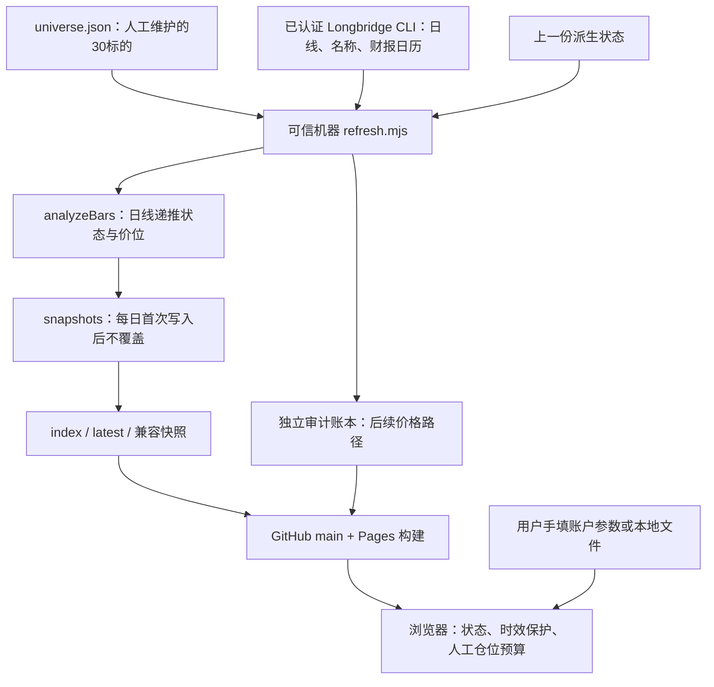

# TailTrend 数据来源、文件契约与更新发布

[README](README.md) · [计算规格](CALCULATIONS.md) · [Claude 清单](CLAUDE_HANDOFF.md)

## 1. 数据血缘和公开范围



| 内容 | 来源与用途 | 公开情况 |
|---|---|---|
| OHLCV与turnover | Longbridge前复权、正常时段日线；计算指标和状态 | 原始数组只在刷新进程内存，不提交 |
| 标的名称 | Longbridge `static`；失败时回退 universe 名称 | 名称可见 |
| 未来财报 | Longbridge `finance-calendar report` | 发布最近一项的日期、timing和label |
| 股票池/行业/集群/角色 | [universe.json](../../tools/tailtrend/universe.json) 人工配置 | 全部公开，不是动态行业分类或统计相关性 |
| 收盘/ATR/价位/HV/均额/状态 | 本项目引擎从行情派生 | 公开精确数值；“不发布原始OHLCV”不等于“不发布任何行情价格” |
| 账户权益/回撤/已有风险 | 网页手填；默认值是示例 | 不发送至服务器；本地导出文件由用户保存 |
| 借券/保证金/持仓 | 无自动来源 | 默认借券不通过；无IBKR集成 |
| 通知/实际订单/成交 | 当前无相应链路 | 无 |

Longbridge 的公开入口为 [开发者文档](https://open.longbridge.com/)；具体命令以接手机器上的 `longbridge --help` 和子命令帮助为准。此处记录的是仓库当前调用契约，未在本次交接中重新认证或抓取实时行情。公开衍生字段是否符合数据授权范围，不能仅靠 privacy 布尔字段推定。

### 1.1 初始股票池

30个标的：SPY、QQQ、IWM、DIA、AAPL、MSFT、NVDA、AVGO、AMD、MU、GOOGL、META、AMZN、NFLX、TSLA、CRM、ORCL、JPM、BAC、GS、V、MA、LLY、UNH、WMT、COST、HD、XOM、CVX、SPXC，后缀均为 `.US`。

这是小型固定研究池，无全市场扫描/动态退市补全。ETF role=benchmark，SPXC role=case-study；**当前代码并不按role阻断交易候选**，DIA在历史快照中通过资格。这与 universe 描述里的“指数ETF仅用于背景”存在差异，接手者需明确产品选择。

## 2. 刷新器实际如何取数

入口：[tools/tailtrend/refresh.mjs](../../tools/tailtrend/refresh.mjs)。从仓库根目录运行，脚本自己通过文件路径定位项目目录。

```bash
longbridge --help
longbridge kline --help
longbridge static --help
longbridge finance-calendar report --help

# 下列为刷新器实际的日线参数示例
longbridge kline DIA.US --period day --count 360 --adjust forward --session intraday --format json
```

1. 读取 universe、latest（缺失回退 tailtrend-snapshot）、index。
2. 记录 UTC `runAt`、纽约日期 `todayEt`，生成 Git/hash 元数据。
3. `static` 一次请求全部symbol。名称依次取 `name_cn/name_en/name`，否则用本地名称。失败只警告。
4. 财报按每组10个symbol、并发2组请求：重复 `--symbol`，从纽约运行日到其后21个日历日，`--count 100`。
5. 日线每标的360根，并发4；每个CLI请求最多3次，重试间隔1秒、2秒，请求通常90秒超时、stdout最大32MiB。CLI日志路径指定临时目录，stdout要求纯JSON。
6. 每标的标准化后取最后日期，用该日期挑最近事件；符合紧邻日期时把previousState传入引擎。
7. 返回派生record、用于审计的最近20根日线、用于缺跑识别的完整可见日期集合。原始数组不写入公开文件。
8. 给record加状态变化、公开riskFactors，生成每日文件和独立审计账本。

财报解析从 `response.list[].infos[]` 读取：symbol由 `counter_id` 尾部market/code组成；日期先取 `ext.local_date`，否则从 `date` 中提取；timing取 `ext.financial_report.market_time` 或date_type。只保留最近一个未来事件，不是完整宏观/公司事件库。

**关键局限**：财报调用失败也只警告，不增加主 `errors`，eventDate会空缺；当运行日已经晚于数据日时，查询起点还可能漏掉数据日与运行日之间的事件。无财报记录不等于已确认没有财报。

## 3. 时间、健康度与失败

| 字段/规则 | 实际语义 |
|---|---|
| record.tradingDate | CLI数组最后一根经标准化后的日期 |
| snapshot.dataAsOf / tradingDate | 所有有效record日期的最大值；没有时回退纽约运行日 |
| runAt / asOf | 此次程序开始处理时的UTC时刻 |
| FRESH | 本次请求成功且行日期与本批最大日期一致；不是实时价格承诺 |
| CACHED | 请求异常后复用旧派生行，按纽约运行日算年龄≤2日 |
| STALE | 失败旧行更老，或该symbol日期落后本批最大日期 |
| missing | 请求池内完全没有record的symbol集合 |
| mode=complete | 无kline异常且record数等于请求数；并未要求每行都是FRESH/非INSUFFICIENT |

`refresh.mjs` 自身不校验交易所正式收盘、不滤未完成当日日线，也没有完整交易日/提前收市表。必须由调用者保证时点；直接盘中运行可能冻结未完成日线。若30个symbol全停在同一个旧日，仍可能得到complete/FRESH。不要把进程exit=0或mode=complete当作完整业务成功。

异常旧行会被设为禁止新仓、riskModule=null、priority=0并加blocker。主刷新失败不会抛出整体异常，而可能生成partial；最终存储将其转换为MISSING，详见下一节。

### 3.1 浏览器自己的过期保护

`tailtrend-app.mjs`：

```text
closedAt = Date.parse(dataAsOf + "T21:00:00Z")
ageDays = max(0, floor((now-closedAt)/86400000))
expired = ageDays > 4
```

加载时过期则保存行原来的publishedDataStatus，覆盖dataStatus为STALE、newPositionAllowed为false，显示提示与0/N健康度。风险表单继承该覆盖。

这是粗粒度保护：整数日龄严格>4，固定21:00 UTC不区分夏令时/节假日；仅在load执行，无持续刷新计时器。raw JSON不会被浏览器修改，其他消费者须自行验证时效。无JS静态回退直接展示构建时字段，也没有执行这段覆盖。

## 4. 持久化文件与版本

```text
portal/vendor/tailtrend/data/
  snapshots/YYYY-MM-DD.json  每个日期首次写入的 COMPLETE 或 MISSING
  index.json                按日期倒序的索引、摘要、健康、状态转换
  latest.json               最近完整快照或安全降级展示副本
  tailtrend-snapshot.json    latest的兼容副本
  tailtrend-audit.json       独立、可追加后续观测的派生账本
  run-history.json           从index重建的run_history_v3摘要
```

### 4.1 append-only 的精确含义

`writeImmutable()` 使用文件打开标记 `wx`。文件已存在就返回已有内容，同一天的第二次运行、换参数或修好网络都不会覆盖。这不是文件系统WORM、签名账本或禁止Git重写的服务。

partial会落为MISSING且records=[]。一旦某日先写MISSING，正常重跑仍保留MISSING，没有已实现的补正版本通道。正式维护不得删除旧文件伪装“第一次就成功”；需要设计独立修订/新epoch路径。

缺跑发现只比较“index最新日期”到“本次dataAsOf”之间、从这次可见日线集合得到的日期。没有新运行就不会补MISSING；不会修复index最新日期之前的内部空洞；不能发现360根历史窗口以外的日期。`missingDates=[]`只说明已持久化索引中没有MISSING。

若最新索引是MISSING且存在较早COMPLETE，latest保留该COMPLETE的日期和数据，改mode、标记missingDataAsOf，把全部record设STALE/禁止新仓。顶层status/summary/dataQuality可能仍来自旧COMPLETE，读者必须查看displayStatus、index和行级闸门。若无任何COMPLETE，latest就是MISSING对象。

这些多个JSON顺序写入，未做多文件原子事务。run-history仅是每日索引摘要，不记录每一次重试，不能替代按标的审计账本。

### 4.2 关键字段

| 字段 | 解释 |
|---|---|
| schema | 快照为 `traderhome_tailtrend_snapshot_v1`；不等同于引擎版本 |
| version / frameworkVersion | 快照格式数字3 / 引擎`0.3.0` |
| engineVersion | 运行时仓库Git HEAD，不一定是最后一次引擎修改的提交 |
| engineDirty | 只检查engine、refresh、snapshot-store、universe四个已跟踪文件；不是整个工作树状态，dirty也未强制阻断 |
| engineSourceHash | `SHA256(JSON.stringify(引擎源码字符串))`，不是直接对文件字节sha256sum |
| paramsHash | 对`{config:TAILTREND_CONFIG,universe}`递归排序对象键后JSON序列化并SHA256；数组顺序保留 |
| prevState / previousObservationDate | 显式保留最近较早COMPLETE的状态与数据日；缺跑时不是严格昨日 |
| transitionReason / stateReason | 当前状态理由数组，不是每一个中间日的转换事件 |
| stateMemory | 未舍入的lower/upper/trend递推输入 |
| locked | 当前活动lower/upper摘要；接受/收复后可为空 |
| signalBoundary / breakout | 本次状态证据；trend持续时仍保留原突破边界/ATR |
| bars | 数字形式的有效根数，不是OHLCV数组 |
| riskFactors | 公开HV/周线分解；账户依赖值为null，bindingConstraint为ACCOUNT_INPUT_REQUIRED |
| privacy | 发布边界声明；需通过代码和测试核对，不能代替审计 |

MISSING对象不完整复制所有COMPLETE元数据（例如当前未带engineDirty），消费者不要假设字段齐全。

审计epoch是 `frameworkVersion:engineSourceHash前12位:paramsHash前12位`。改变README不重启epoch；只改刷新/存储脚本也不改变engineSourceHash，不能认为epoch涵盖所有行为变化。上一状态种子选择没有版本一致性校验，同日existing快照和新epoch的兼容性需显式处理。

## 5. 前端、静态站与本地导入

- 浏览器用 `cache:no-store, credentials:omit` 读取latest/index/audit。latest错误时不显示旧信号；index/audit非2xx可降级为空，但网络拒绝或无效JSON仍可能使整体load失败。
- 台式表格、手机卡片和详情抽屉使用同一记录；HTML内容经过转义。
- 本地配置导出只有账户权益、滑点、回撤、组合/集群热度、日止损次数和亏损，schema为`traderhome_tailtrend_local_risk_config_v1`；导入上限100KiB。不会导入模块/入场/止损/事件准备金，不写localStorage。
- K线导入最大5MiB，至少90根有效日线；JSON支持数组或`data/bars`数组，CSV是简单逗号拆分，不支持复杂引号/逗号字段。字段为time/date/timestamp、OHLC、volume、turnover。
- 本地结果dataStatus=LOCAL，只显示研究详情；不会自动替换主表选中记录或主仓位表。缺turnover会显示警告，最近20根只要有一个有效正turnover就认为可用，未验证20根覆盖。
- [build_site.py](../../portal/build_site.py)复制TailTrend目录到站点，注入共享外壳与静态表格；无JS时可看构建日快照，但交互/仓位不可用。
- 全站freshness清单另用TailTrend数据日21:00UTC、96/168小时阈值，和TailTrend页面的整数日龄>4不完全相同。

## 6. 当前调度与GitHub部署

### 6.1 Mac端行情刷新

见 [scheduler README](../../tools/scheduler/README.md)、[refresh-runner.mjs](../../tools/scheduler/refresh-runner.mjs)。TailTrend的launchd每小时本机`:40`唤醒，用纽约时钟决定数据是否到期：工作日16:20ET以后目标是当天，否则为前一个工作日；周末回到周五。该函数跳过周末，未内置交易所假日表。

专用clone默认在用户主目录下 `.traderhome/refresh-repo`，必须有安装器创建的`.git/traderhome-refresh-clone`标记。runner会同步并清理这个专用clone，检查Longbridge SPY报价，刷新、跑TailTrend与门户测试，仅提交TailTrend data目录并推main；有全局运行锁和最多3次推送重试。

**开发不要放在这个会被重置的专用clone中。** 标记不是给普通工作树绕过保护的办法。日志位于用户主目录`.traderhome/logs/`，关注refresh-status.json的lastSuccessAt、stamp、message和job日志。

目前“刷新后latest数据日未前进”会被当作无新交易日，并丢弃data目录变化。这在休市日合理，但也可能丢弃此次新建的MISSING和审计更新，见已知缺口。源码存在不代表已经安装、登录有效或在后台成功运行。

安装命令（本次未执行）：

```bash
bash tools/scheduler/install-macos.sh
```

安装器同时配置TailTrend、IncomeOS研究、IncomeOS周五、早晚报四个任务；`--run-now`还会立即运行其中三个流程，不适合作为“只检查TailTrend”的无副作用命令。手动`--force`绕过到期判断，不会覆盖同日不可变快照，也不自动过滤未收盘K线。

### 6.2 GitHub端

| 工作流 | 实际作用 |
|---|---|
| [daily-refresh](../../.github/workflows/daily.yml) | 00:35/06:30UTC、特定push或手动运行；测引擎，刷新历史研究和公开OTC价格等；**不调用TailTrend refresh.mjs** |
| [publish-traderhome](../../.github/workflows/pages.yml) | main指定路径push、daily-refresh成功、手动或每小时6/16/26/36/46/56分定时；构建最新main、上传并部署Pages |

TailTrend数据推main会命中portal路径触发发布；README或tools/tailtrend更改可触发daily-refresh并在成功后衔接发布。其他模块使用的Secrets不等于已配置Longbridge；不要为了TailTrend直接复制凭据到公开仓库或现有Actions。

## 7. 可复现命令与更新步骤

环境：Node22+、Python3.11+；纯TailTrend引擎与快照存储使用Node内建模块，不需要npm install。行情刷新另需本机LongbridgeCLI和有效行情权限。完整全站工作流依赖见daily.yml。

在**完整仓库的独立开发检出**中先运行不联网验证：

```bash
node --test portal/test_tailtrend_engine.mjs tools/scheduler/test_refresh_runner.mjs
python3 -m unittest portal.test_portal
python3 portal/build_site.py --output _site
python3 -m http.server 4173 --directory _site
# 浏览器打开 http://127.0.0.1:4173/tailtrend/
```

不要只直接打开vendor/index.html；模块与JSON使用站点绝对路径。门户测试和构建需要完整vendor、prototype等目录。实际采集前先查看帮助、验证认证和行情时效，确认美股目标日已收盘，并检查同名日文件是否已存在，然后：

```bash
node tools/tailtrend/refresh.mjs
node --test portal/test_tailtrend_engine.mjs
python3 -m unittest portal.test_portal
git diff --check
git diff --stat -- portal/vendor/tailtrend/data
```

检查dataAsOf/真实目标日、每行日期、health、事件查询结果、engineDirty/hash、COMPLETE/MISSING、旧日文件未变化、审计forward是否连续，然后只暂存审过的数据路径。算法修改应先版本化，再以干净代码生成新研究记录；同日已冻结时必须使用明确的修订方案，不能强行覆盖。

推送后分别验证GitHub文件和公开站点的dataAsOf、engineVersion、index、状态闸门与过期行为。Pages成功仅证明部署，不证明当天行情成功取得。日志、GitHub令牌、Longbridge凭据、账户配置文件和原始K线不得作为交接资料提交。

## 显式同日新版研究重算（不是历史信号修订）

仅经明确授权后运行 `node tools/tailtrend/refresh.mjs --research-revision`。
它重新获取完整数据并执行原有30标的、日线、日历与源质量门禁；需要已有同日
COMPLETE原始快照以及不同引擎哈希。通过后独占创建
`data/revisions/YYYY-MM-DD-完整引擎hash.json`，再更新 `latest.json` 和
`tailtrend-snapshot.json` 展示别名。页面明确显示“事后新版研究重算，非当时信号”。
实际重算时间记录为runAt，数据日不变；revision provenance记录原始快照路径、
runAt和原始字节SHA256。不能把重新获取时间说成原始信号发布时间。

所有 `snapshots/`、`index.json`、`run-history.json`、`tailtrend-audit.json`
逐字保持；不补漏跑、不中途修改审计epoch、不回填历史收益。revision不输出
假装当时发布的状态转换。重复引擎/数据日的revision拒绝覆盖，失败须先读回核对；
别名各自原子替换，但两个文件不构成跨文件事务，中断时需核对immutable revision
及两个别名后恢复，不能假称发布成功。普通同日刷新在现有revision存在时明确
拒绝降级到旧快照；下一完整交易日仍按原正常流程生成，不改任何定时。
